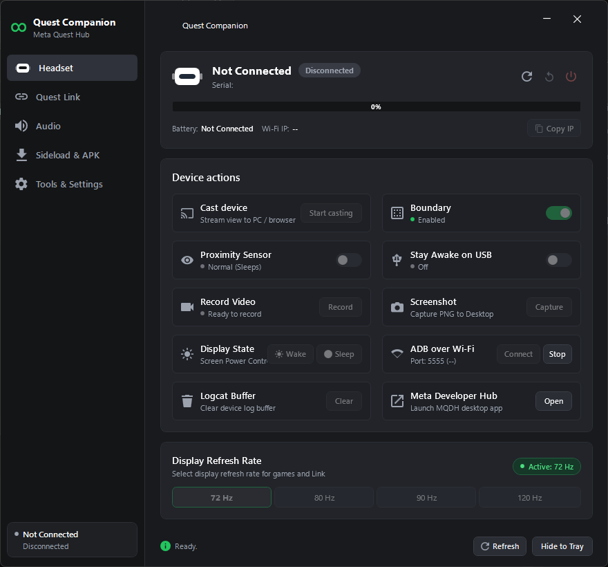
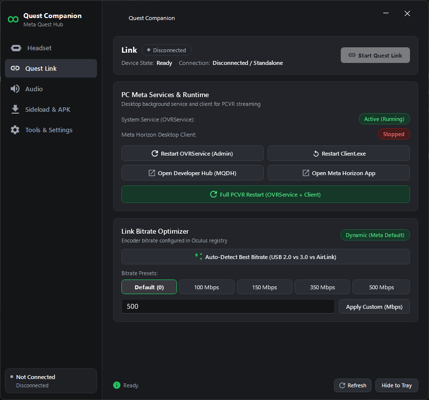
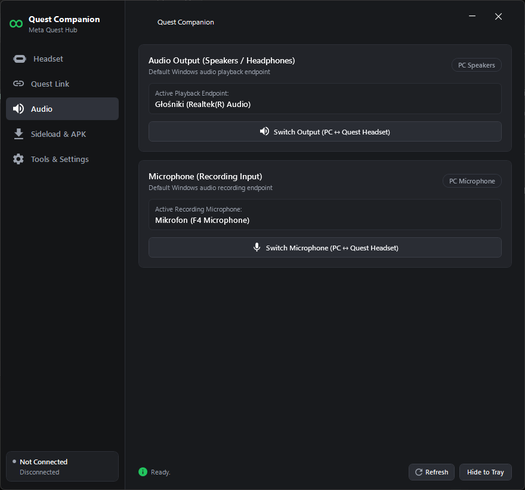
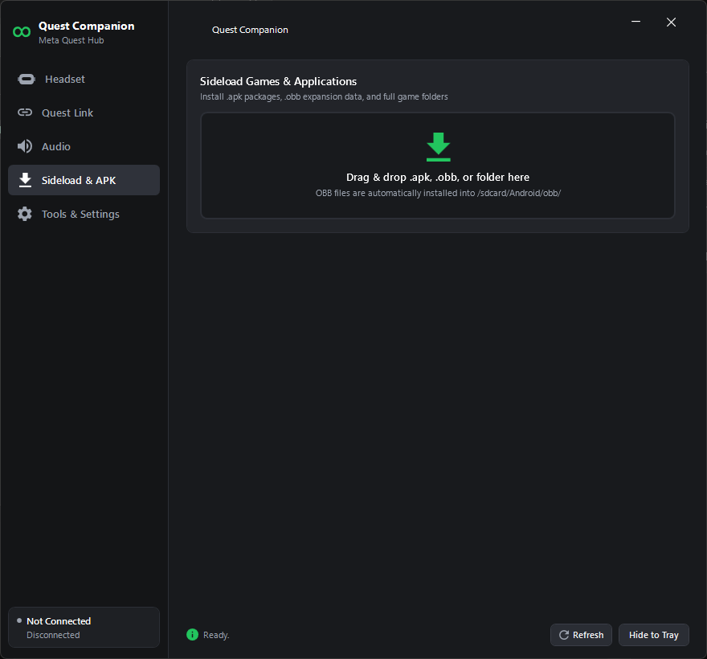

# Quest Companion

<p align="center">
  <strong>A modern, lightweight Windows system tray utility for Meta Quest headsets (Quest 2, Quest 3, Quest Pro) and PCVR streaming.</strong>
</p>

---

## 📸 Screenshots

<p align="center">
  <strong>Headset Management & Quick Actions (MQDH Style)</strong><br />
  
</p>

<p align="center">
  <strong>PCVR Link & Dynamic Bitrate Optimizer</strong><br />
  
</p>

<p align="center">
  <strong>Audio & Microphone Routing Switcher</strong><br />
  
</p>

<p align="center">
  <strong>Sideload & APK / OBB Manager</strong><br />
  
</p>

---

## ✨ Features

- **🥽 Headset Management & Dashboard:**
  - Real-time battery status with percentage and charging indicators.
  - Live Wi-Fi IP display with one-click IP copy.
  - Quick power controls: Refresh, Reboot, and Shutdown.
  - Display control: Force Wake and Sleep modes.
  - Wireless ADB over Wi-Fi (port 5555) toggle and connect.

- **🛡️ Guardian & Privacy Tools:**
  - **Boundary (Guardian) Toggle:** Easily pause/resume boundary for seated PCVR or desktop work.
  - **Proximity Sensor Bypass:** Toggle proximity sensor sleep behavior (Always awake vs Normal).
  - **Stay Awake on USB:** Prevent headset display from going to sleep while plugged in.

- **🎥 Screen Mirroring & Recording:**
  - **Cast Device (Screen Mirroring):** Launches low-latency `scrcpy` (if found) or opens official Meta Casting portal.
  - **High-Definition Video Recording:** Record 1080p MP4 videos directly from the headset with automatic pull to PC upon stopping.
  - **Screenshot:** Capture PNG snapshots from headset display directly to your PC.

- **⚡ PCVR Link & Dynamic Bitrate:**
  - One-click OVRService restart & Meta Horizon client relaunch.
  - Dynamic & preset bitrate tuning (H.264 / HEVC / AV1 friendly).
  - Audio and microphone output routing switches (PC ↔ Headset).

- **📦 Sideloading & APK / OBB Manager:**
  - Drag-and-drop `.apk` and `.obb` files or game folders for automatic sideloading onto headset.

- **🔔 System Tray & Windows Integration:**
  - Runs quietly in the Windows system tray with live connection status LED (green when connected, gray when disconnected).
  - Optional "Start with Windows" background startup.
  - Dark mode styled after Meta Quest Developer Hub (MQDH) and Windows 11 Fluent Design.

---

## 🚀 Downloads

Visit the [**Releases**](https://github.com/Michal/Quest-Companion/releases) page to download the latest version:

1. **`QuestCompanion-v1.0.0-win-x64-standalone.zip`** *(Recommended)*
   - Contains a single, completely standalone `Quest Companion.exe`.
   - Bundles the .NET 10 desktop runtime inside — zero installation required, runs on any Windows 10/11 64-bit PC out-of-the-box!
2. **`QuestCompanion-v1.0.0-win-x64-framework-dependent.zip`**
   - Contains a single lightweight `Quest Companion.exe` (~4 MB compressed).
   - Requires [.NET 10 Desktop Runtime](https://dotnet.microsoft.com/download/dotnet/10.0) installed on the system.

---

## 🛠️ Building from Source

### Prerequisites
- Windows 10 / 11 (64-bit)
- [.NET 10 SDK](https://dotnet.microsoft.com/download/dotnet/10.0)
- Visual Studio 2026 / VS Code / Rider

### Build & Run
```powershell
# Clone the repository
git clone https://github.com/michalzembron/Quest-Companion.git
cd Quest-Companion

# Build and run
dotnet build
dotnet run --project "Quest Companion\Quest Companion.csproj"
```

### Create Release Packages
Run the automated packaging script:
```powershell
.\build_release.ps1
```
The output ZIP archives and SHA256 checksums will be generated in `releases/`.

---

## 📄 License
This project is open-source under the MIT License.
